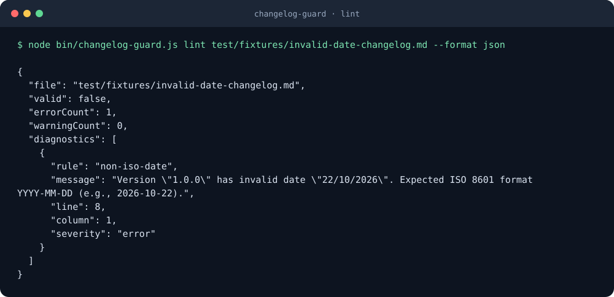

# changelog-guard

[](https://github.com/YusufBeratZengin/changelog-guard/actions/workflows/ci.yml)
[](LICENSE)
[](package.json)
[](https://www.npmjs.com/package/changelog-guard)

Lint your changelog, require release notes in pull requests, and prepare releases with zero runtime dependencies.

[Türkçe](README.tr.md) · [Contributing](CONTRIBUTING.md) · [Report a bug](https://github.com/YusufBeratZengin/changelog-guard/issues/new/choose)



## Why

- **One focused tool:** validate [Keep a Changelog 1.1](https://keepachangelog.com/en/1.1.0/) headings, dates, links, change types, and [SemVer 2.0.0](https://semver.org/spec/v2.0.0.html) ordering.
- **Release notes stay with the code:** `check-pr` requires an addition under `[Unreleased]` when selected source files change; explicit labels and commit trailers handle exceptions.
- **Small footprint:** no runtime dependencies or required configuration file; release preparation preserves existing line endings and unrelated content.

## Quick start

Requires **Node.js 20+** and **Git** (`check-pr` also needs local Git history). Run from a source checkout; no install step or published npm package is needed:

```bash
git clone https://github.com/YusufBeratZengin/changelog-guard.git
cd changelog-guard
node bin/changelog-guard.js --version
node bin/changelog-guard.js lint CHANGELOG.md
```

Expected output from the last two commands:

```text
0.1.0
CHANGELOG is valid. No issues found in CHANGELOG.md
```

The npm badge tracks registry availability; it may show an unavailable version before the first publication. The source checkout works independently of npm publication.

## Usage examples

All commands below run from the repository root. Use `node bin/changelog-guard.js --help` for the full option list.

### Lint

```bash
node bin/changelog-guard.js lint
node bin/changelog-guard.js lint docs/CHANGELOG.md
node bin/changelog-guard.js lint --allow-empty-unreleased
node bin/changelog-guard.js lint --no-require-unreleased
node bin/changelog-guard.js lint --check-orphans
```

Reproduce the demo using the intentionally invalid test fixture. This command exits **1** and emits a `non-iso-date` diagnostic with its line and column:

```bash
node bin/changelog-guard.js lint test/fixtures/invalid-date-changelog.md --format json
```

Lint rules: `heading-structure`, `unknown-change-type`, `non-iso-date`, `versions-not-descending`, `invalid-semver`, `duplicate-version`, `missing-link-reference`, `empty-section`, and `unreleased-missing`. Optional `orphan-link-reference` diagnostics are warnings.

### Check a pull request

Compare committed changes against a locally available base ref:

```bash
node bin/changelog-guard.js check-pr --base origin/main
node bin/changelog-guard.js check-pr --base origin/main --head HEAD --user-facing "src/**,lib/**,packages/**" --ignore "**/*.test.js,**/*.spec.ts"
```

For an intentional exception, use a commit message body containing `Changelog: skip`, a message tag such as `[skip changelog]`, or a configured PR label. Labels are read automatically from the GitHub event payload; outside Actions, pass `--labels no-changelog`.

### Prepare a release

Preview first; omit `--dry-run` to write the file:

```bash
node bin/changelog-guard.js release 0.2.0 --date 2026-10-23 --dry-run
```

`release` moves entries from `[Unreleased]` to a dated version and updates comparison links. It edits the changelog only; tagging and publishing are separate maintainer steps.

### Create a changelog

```bash
node bin/changelog-guard.js init docs/CHANGELOG.md
```

The parent directory must already exist. `init` refuses to overwrite an existing file.

### GitHub Action

```yaml
name: Changelog
on:
  pull_request:
    branches: [main]
permissions:
  contents: read
jobs:
  changelog:
    runs-on: ubuntu-latest
    steps:
      - uses: actions/checkout@v4
        with:
          fetch-depth: 0
      - uses: actions/setup-node@v4
        with:
          node-version: '22'
      - uses: YusufBeratZengin/changelog-guard@main
        with:
          mode: both
          base: ${{ github.event.pull_request.base.sha }}
          head: ${{ github.event.pull_request.head.sha }}
```

This example uses `main` so it does not depend on a release tag. Pin the action to a reviewed commit for reproducible builds. Fetch the base and head history, and set up Node.js before the composite action.

### JavaScript API

The same operations are available as ES modules in a source checkout:

```javascript
import { readFileSync } from 'node:fs';
import { lintChangelog, executeRelease } from './src/index.js';

const content = readFileSync('CHANGELOG.md', 'utf8');
const result = lintChangelog(content);
console.log(result.valid, result.diagnostics);

const preview = executeRelease(content, '0.2.0', { date: '2026-10-23' });
console.log(preview.content); // Returns text; does not write a file.
```

The entry point also exports the parser, file-based release helper, formatters, and `semver` and `glob` utilities. See [src/index.js](src/index.js) for the full export list.

## Configuration

Configure the CLI with flags; there is no configuration file.

| Command | Option | Default / behavior |
| --- | --- | --- |
| `lint` | `[file]` or `--file` | `CHANGELOG.md` |
| `lint` | `--format` | `stylish`; use `json` for automation |
| `lint` | `--allow-empty-unreleased` | Off; allow an empty version block after release |
| `lint` | `--no-require-unreleased` | Off; omit the requirement for `[Unreleased]` |
| `lint` | `--check-orphans` | Off; warn about unused version link references |
| `check-pr` | `--base` / `--head` | Required base / `HEAD` |
| `check-pr` | `--file` | `CHANGELOG.md` |
| `check-pr` | `--user-facing` | `src/**,lib/**` |
| `check-pr` | `--ignore` | `**/*.test.*,**/*.spec.*,**/test/**,**/tests/**,**/*.d.ts,**/*.map` |
| `check-pr` | `--skip-trailer` | `Changelog: skip` |
| `check-pr` | `--skip-labels` | `no-changelog,skip-changelog,chore,dependencies` |
| `check-pr` | `--labels` | `PR_LABELS`, then labels from `GITHUB_EVENT_PATH` |
| `release` | `--file` / `--date` | `CHANGELOG.md` / today's local date (`YYYY-MM-DD`) |
| `release` | `--dry-run` | Off; print the updated file without writing |

The Action accepts `mode` (`both`, `lint`, or `check-pr`), `file`, `base`, `head`, `user-facing`, `ignore`, `skip-trailer`, `skip-labels`, and `allow-empty-unreleased`. See [action.yml](action.yml) for exact defaults; its ignore list omits `**/*.map`. `check-pr` runs only on `pull_request` events in the composite action.

## FAQ / Limitations

**What do exit codes mean?** Lint errors, failed PR checks, and command failures exit `1`; successful checks and explicit skips exit `0`. Orphan-link warnings alone do not fail lint.

**Can `[Unreleased]` be empty?** Use `--allow-empty-unreleased` after a release. Empty `### Added` or other change-type headings are still errors; remove unused headings.

**Does `check-pr` understand my changes?** It matches file globs and looks for new bullet text or changed prose under `[Unreleased]`. It does not assess whether a note accurately describes the code. It compares committed Git refs and can read the working-tree changelog; use a clean checkout in CI.

**What glob syntax is supported?** `*`, `**`, `?`, and simple brace expansion in the API. CLI file lists are comma-separated; use `src/**,lib/**` rather than braces containing commas. Use `--ignore` for exclusions. This is a small matcher, not a complete shell or gitignore implementation.

**Does release preparation validate every date?** `lint` checks real calendar dates. `release --date` checks the `YYYY-MM-DD` shape; lint the result too. Common comparison URLs are updated, but review custom hosting URLs with `--dry-run`.

**Do I need a token or external service?** The CLI runs locally. CI coverage uses Node's built-in test runner; there is no coverage upload service to configure.

## Contributing

See [CONTRIBUTING.md](CONTRIBUTING.md) for the workflow and [SECURITY.md](SECURITY.md) for vulnerability reporting. From a checkout:

```bash
npm test
npm run lint
npm run demo
```

`npm test` prints line, branch, and function coverage. Tests include temporary Git repositories, so Git must be installed. The JavaScript project currently has no separate typecheck command. Keep both READMEs aligned; regenerate [docs/demo.svg](docs/demo.svg) with [scripts/make-demo.mjs](scripts/make-demo.mjs) when its command or output changes.

## License

[MIT](LICENSE).
